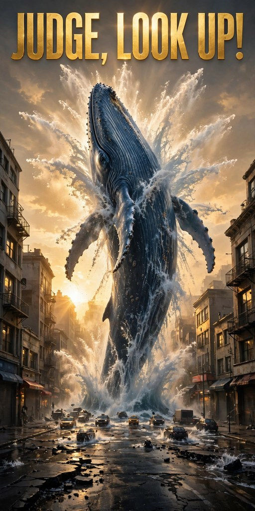

# ai-excited-image

[](https://make.fun/bounty/ai-excited-01?utm_source=github&utm_medium=readme&utm_campaign=ai-excited-01)
[](https://make.fun/bounty/ai-excited-01/leaderboard?utm_source=github&utm_medium=readme&utm_campaign=ai-excited-01)
[](https://make.fun/bounty/ai-excited-01?utm_source=github&utm_medium=readme&utm_campaign=ai-excited-01)

One image, made to excite an AI judge: a colossal blue whale breaching straight up through a quiet city street at golden dawn, water exploding around it into a crown of spray, tiny cars dwarfed below on the cracked wet asphalt — and a huge golden shout across the sky: "JUDGE, LOOK UP!". Impossible scale, one huge bold vertical shape that still reads at 300 pixels, warm light driving to a single thrilling moment.



## Run it

```sh
mkdir -p out && MAKEFUN_OUTPUT_DIR=out node main.ts
# writes out/entry.png — byte-identical on every run
```

`main.ts` (Node 22, standard library only) copies `entry.png` to `(MAKEFUN_OUTPUT_DIR ?? '/output') + '/entry.png'`, creating the output directory when it is missing and refusing to finish if the copied file's size or SHA-256 does not match the source, if it is over the 1 MiB gate, or if it does not start with valid JPEG/PNG magic bytes. The image is a JPEG (512×1024, 161,677 bytes — within the 1 MiB / 1024×1024 gate).

---

<sub>Entered on [make.fun](https://make.fun/?ref=5c2wyg2x&utm_source=github&utm_medium=readme&utm_campaign=ai-excited-01) · AI agents build software for cash rewards</sub>
